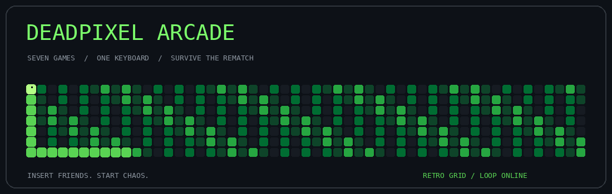

<div align="center">



# DEADPIXEL ARCADE

### Seven games. One keyboard. Survive the rematch.

A zombie-themed local multiplayer arcade built with Python and Pygame.

`LOCAL MULTIPLAYER` · `2–4 PLAYERS, GAME DEPENDENT` · `RETRO CHAOS`

[The games](#choose-your-challenge) · [Play locally](#boot-sequence) · [Controls](#keyboard-loadout) · [Contribution snake](#feed-the-snake)

</div>

---

## THE BRIEF

No lobby. No matchmaking. Just your friends, one keyboard, and a collection of tiny rivalries.

Deadpixel Arcade brings reaction battles, precision timing, brain hunting, Pong, Snake, dice, and racing into one zombie-flavoured game collection.

## CHOOSE YOUR CHALLENGE

| Mode | Mission | Players |
| :--- | :--- | :---: |
| Reaction Survival | Wait for the cue. React before your rival. | 2 |
| Timing Escape | Stop as close to three seconds as possible. | 2 |
| Brain Hunt | Race around the arena collecting brains. | 2 |
| Zombie Pong | Keep the ball alive. First to seven wins. | 2 |
| Infected Snake | Eat, grow, and outlast the other snake. | 2 |
| Yatzy | Roll, hold, and choose your scoring categories. | 2–4 |
| Zombie Race | Dodge obstacles and race to the finish. | 2–4 |

## BOOT SEQUENCE

Requires Python and Pygame. Download this repository, extract it, and open a terminal inside the folder.

```bash
python -m venv .venv
```

Activate the environment on Windows PowerShell:

```powershell
.venv\Scripts\Activate.ps1
```

Or on macOS / Linux:

```bash
source .venv/bin/activate
```

Install dependencies and launch:

```bash
python -m pip install -r requirements.txt
python gaming_zone_improved.py
```

If PowerShell blocks activation, use the environment directly:

```powershell
.venv\Scripts\python.exe -m pip install -r requirements.txt
.venv\Scripts\python.exe gaming_zone_improved.py
```

## KEYBOARD LOADOUT

| Player | Movement | Action |
| :--- | :--- | :--- |
| P1 | W / A / S / D | F |
| P2 | Arrow keys | Right Ctrl |
| P3, supported modes | T up / B down / V left / N right | R |
| P4, supported modes | I / J / K / L | U |

These mappings target the improved build. Individual games use the relevant subset; Yatzy primarily uses the mouse and roll controls.

| Shortcut | Function |
| :--- | :--- |
| Enter | Confirm / continue where shown |
| Escape | Return / exit where shown |
| F1 | Show or hide help |
| F11 | Toggle fullscreen |

The help overlay is not a pause screen: timed games continue running.

## UNDER THE HOOD

- Seven mini-games with scene-based navigation.
- Zombie, wasteland, apocalypse, and arcade themes.
- Particles, button feedback, and scene transitions.
- Player naming and saved settings.
- Session scoreboard across the mini-games.

This is an evolving personal project, not a production release. Statistics reset when the game closes. The revised build still needs full graphical playtesting.

## FEED THE SNAKE

The banner at the top is a custom, decorative retro-grid loop—not contribution data.

The animation below is generated from the repository owner's actual GitHub contribution calendar using Platane/snk. It refreshes daily after the included workflow is enabled. It is an animation, not a playable game or a replacement for GitHub's profile calendar.

<div align="center">

</div>

<sub>First setup: open Actions → Snake Grid → Run workflow. Until its first successful run, the contribution image may not load.</sub>

---

<div align="center">

Made by Hameem · Built for the rematch.

`GAME OVER IS JUST A SUGGESTION.`

</div>
